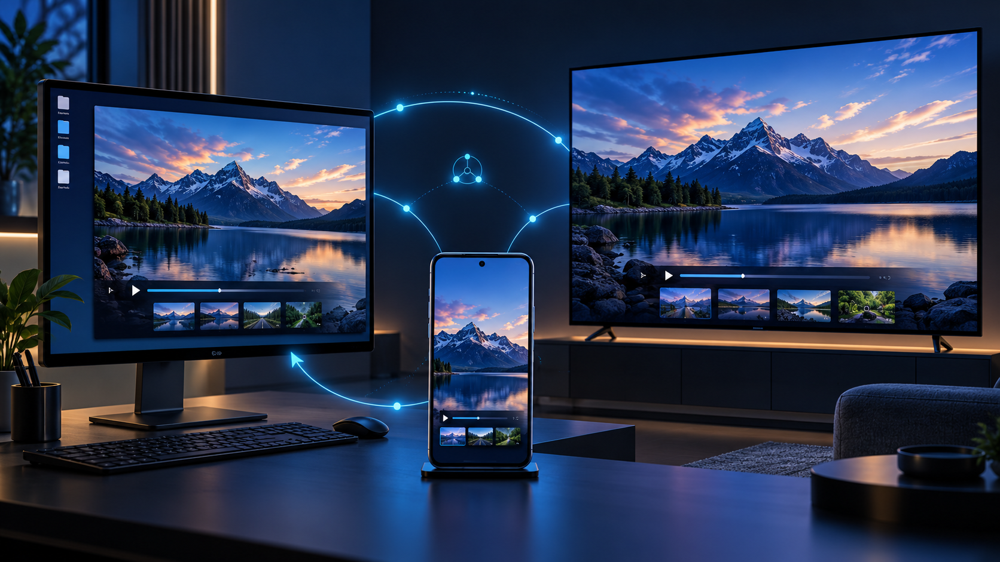

# MirrorMesh

<p align="center">
  Local screen sharing across personal devices, with explicit approval and no cloud account.
</p>

<p align="center">
  
  
  
  
  
</p>

<p align="center">
  
</p>

<p align="center"><em>Concept artwork, not an in-app screenshot. Platform readiness varies; see the status table below.</em></p>

**Version 0.4.1 is the final repository checkpoint for now**, with the limitations below.
It is a personal-use preview, not a claim of production or universal device compatibility.

## Apps and current readiness

| Product | What it does | Evidence |
| --- | --- | --- |
| Windows x64 | Send to MirrorMesh receivers; receive Android/MirrorMesh and native iPhone/iPad AirPlay | Build verified; app sharing and AirPlay connections previously confirmed by the owner |
| Android phone/tablet ARM64 | Receive a PC screen; send Android screen with OS permission | Debug and unsigned optimized APKs build verified; earlier app sharing owner-confirmed |
| Android TV / Google TV ARM64 | Receive PC screen; send TV screen where the TV permits capture | APK build verified; physical TV use unverified |
| Linux x64 | Shared desktop sender/receiver | Ubuntu 24.04 build verified; desktop keyring, capture and media unverified |
| macOS ARM64 / Intel | Desktop sender/receiver source | Source only; requires a Mac/Xcode to build and verify |
| iOS app | Receive PC screen; ReplayKit sender source | Source only; requires Mac/Xcode, provisioning and device verification |

Windows Miracast opens Microsoft's separate Wireless Display app. Connection failures
remain unresolved; the app reports OS listening state without claiming media success.
Google Cast reception is unavailable: no compatible free Windows provider was verified.
Native iOS AirPlay does **not** require installing the MirrorMesh iOS app.

## Start here

1. [Build your personal apps](docs/build-release.md), or use a complete locally built bundle.
2. [Install and connect](docs/USER_GUIDE.md). For television APKs, use the [TV installation guide](docs/install-android-tv.md).
3. Start receiving on the target device, then find it from the sender or use its current invitation.
4. Compare the connection code when requested. Review device information, select **Allow view**, then **Approve**.
5. Select the screen/window or approve the OS capture prompt. Stop/Disconnect ends capture.

Use the same reachable, trusted LAN. Invitations expire and are single-use. Update sender
and receiver together. Device names/models are signed **reported facts**, not hardware attestation.
Screen sharing through MirrorMesh is video-only; the separate AirPlay pipeline handles its own media.

## Build the products

Install the pinned tools in the [build guide](docs/build-release.md), then run from the repository root:

```powershell
# Windows: complete EXE/DLL/assets/AirPlay bundle
.\scripts\setup-airplay-toolchain.ps1
.\scripts\build-windows.ps1

# Native Android: phone and TV flavors; installable local debug signature
.\scripts\build-android.ps1 -Configuration debug

# Optimized Android: unsigned unless your private signing environment is configured
.\scripts\build-android.ps1 -Configuration release

# Linux x64 from Windows, using Docker Desktop's Linux engine
.\scripts\build-linux-docker.ps1
```

On Linux: `sh scripts/build-linux.sh`. On a Mac: `sh scripts/build-macos.sh`.
The iOS extension/provisioning steps are documented separately in the build guide.
Build scripts work from `main`, a release checkout, or an extracted source archive;
they do not change Git branches or run unit/instrumentation suites.

Generated products go under `releases/`. Keep every DLL and the `data/` folder with the
Windows EXE; it is not a standalone file. Linux likewise needs its `lib/` and `data/` folders.
Windows is unsigned. Android `debug.apk` is installable; `release-unsigned.apk` is not.
No macOS/iOS binary was produced on the Windows/WSL build machine.

## Code and workspace

```text
apps/
  android-tv/             Native Android phone + TV app, Java/WebRTC/JNI
  mirrormesh_flutter/     Shared Flutter UI and Windows/Linux/macOS/iOS hosts
crates/                  Shared Rust identity, trust, protocol, sessions and adapters
scripts/                 Local builds, packaging, native AirPlay bridge and diagnostics
docs/                    Architecture, build/use guides, protocol and actual readiness
releases/                Output folders and public checksums; generated payloads ignored
Cargo.toml / Cargo.lock  Rust workspace and locked dependencies
rust-toolchain.toml      Rust compiler/target pins
```

[Architecture and detailed code map](docs/ARCHITECTURE.md) explains each layer and platform path.
[Readiness](docs/IMPLEMENTATION_STATUS.md) separates source, compilation and hardware evidence.
The native Android app is the only APK implementation; the obsolete Flutter Android shell
and unfinished browser prototype are preserved in the `test_6` checkpoint, outside this release tree.
Older task plans, test history and draft ADRs remain in Git history. Current decisions are in `docs/adr/`.

SDKs/caches (`.toolchains/`, `target/`, app build directories), editor preferences, local
receiver state and extracted personal bundles are not release source. Keep signing keys,
passwords and runtime identity files outside Git. Packaged third-party notices and matching
AirPlay source/license materials are required parts of complete binary bundles.

## FAQ — connection and playback

### An invitation is rejected, expired, or never reaches approval

Start the receiver first, refresh its invitation and use the complete copied link or current QR.
Enable automatic time on both devices. Use matching app versions. An invitation is not a
browser search URL and must not be shortened by dropping authentication fields. For nearby
devices, select the discovered device and compare the code on both screens.

### “Bad state: approved control message failed protocol or transport checks”

Update both apps to the current matching build and pair again with a fresh invitation.
Earlier Android capture startup exposed signaling/lifecycle incompatibilities that were
corrected. If it recurs, share the app version, direction and sanitized error text; do not
disable identity or transport checks. Never share the full invitation or pairing code.

### The phone stays on “Connecting…” and Windows Wireless Display shows nothing

This is the native Miracast path, separate from MirrorMesh app sharing. Open **Android
wireless display options → Wireless display / Miracast** and check the popup's actual
listening state. Keep the Windows receiver open; inspect **Projection settings** and
the Wi-Fi/display manufacturers' driver support. Discovery alone does not prove a working
connection. Run `scripts/diagnose-miracast.ps1` for read-only status. This failure is not
verified as fixed; use MirrorMesh on both devices for the owner-confirmed app path.

### Can I use Android's Google Cast button?

No compatible Google Cast receiver is bundled. Cast and Miracast are different protocols.
Use Android Wireless display/Miracast where supported, or the MirrorMesh Android app.
No paid provider or trial is installed automatically.

### iPhone/iPad does not find the PC, or AirPlay stops immediately

Extract the complete current Windows ZIP into a new folder. Start the AirPlay receiver
and wait for readiness. Earlier builds had missing/misplaced native runtime DLLs/plugins;
copying only the EXE or mixing old/new DLLs can reproduce startup errors such as `0xC0000135`.
See [AirPlay setup](docs/airplay.md). Use the same reachable LAN and permit only the app's
required private-network access if Windows asks; do not disable the firewall or Defender.

### iOS asks for an AirPlay code but the PC displays none

The code appears only after the iOS authentication request. Use the current complete
Windows build: earlier code retention across short socket closures was fixed. Check the
PC's code popup, enter it on iOS, then approve the separate PC request. Restart reception
if the code expired. Do not run multiple old receiver instances.

### The mirrored phone screen is too tall, clipped or scrolls

Update the PC app. The receive view fits the video within its window and preserves aspect
ratio. Maximize or use the fullscreen control. Native AirPlay also supports F11/Escape.
Black bars can be normal when device aspect ratios differ.

### Devices are missing from nearby search, or no LAN interface is available

Start receiving on the destination and use Wi-Fi/Ethernet on the same reachable LAN.
Guest/client isolation, VPN routing and blocked local discovery can prevent pairing.
Discovery is a hint, not authentication; current QR/link pairing remains available.
The app selects one physical LAN interface and hides local addresses during normal setup.

### Pairing works but there is no picture, or it disconnects after starting

Approve the sender's OS capture prompt and choose a valid source. Protected content may
be blank; it is not bypassed. Check receiver codec support and sender diagnostics. Encoded
frame/byte counters prove sender activity only. A visible changing picture proves reception.
A short interruption has a bounded recovery period; after failure, refresh and pair again.

## FAQ — installation and builds

### How do I install the TV APK? Can I use a phone cable?

Use the **TV** debug APK on Android TV/Google TV with an ARM64 Android OS. USB drive plus
a TV file manager is the simplest route. A phone cable works only if the TV can browse
the phone's MTP storage; it is not an automatic installer. Wireless ADB is another option.
See [all installation steps](docs/install-android-tv.md). Non-Android TV systems cannot install it.

### Android says the APK is incompatible, unsigned, or cannot update

Check Android OS ABI, package flavor and signing certificate. A 64-bit chip can run a
32-bit TV OS. Use a locally signed debug APK for personal previews; optimized unsigned APKs
need your own private signing configuration. Keep the same signing key for updates.
Uninstalling a differently signed app erases its local trust/settings, so back those up appropriately first.

### Windows build fails on plugin symlinks or Git ownership

Enable Windows Developer Mode for Flutter symlinks. Keep the repository/SDK in writable
locations owned by your account. If Git reports dubious ownership, repair ownership or
add **only your explicitly trusted repository/SDK path** to Git's safe-directory setting.
Do not trust all directories. Re-run the pinned dependency/build commands afterward.

### Defender blocks a script or a documentation edit

Keep the exact command and intended behavior for review. Inspect whether the file was
partially changed, then use a transparent patch for ordinary edits. Do not encode scripts
to evade inspection, change execution technique solely to evade detection, or disable protection.

### Linux pairing cannot open identity storage

Run as your desktop user with a session D-Bus and an unlocked Secret Service keyring.
Headless Docker builds do not provide that desktop session. The app fails closed instead
of writing identity seeds as plaintext. Linux media/Wayland/GPU behavior still needs verification.

### Can Windows/WSL produce macOS or iOS releases?

Not with this build setup. Apple targets need a Mac, Xcode and appropriate signing/provisioning.
The source and build instructions are included; no Apple binary is claimed. Do not replace
secure Keychain storage or permissions just to make an unsigned preview appear functional.

### What can I safely share when reporting a problem?

Share app versions, platform/direction, sanitized error messages and media counters.
Replace machine paths, device identities and network endpoints with generic placeholders.
Do not include credentials, private keys, invitations, PINs, keystores or personal receiver state.

## Release and verification policy

Builds, formatters and static analysis are used locally. This release tree has no test suites,
fuzz targets or GitHub Actions. Physical verification remains separate. `CODE_COMPLETE`,
`BUILD_VERIFIED` and `HARDWARE_VERIFIED` are distinct; the full original product scope is not complete.
See [verification boundaries](docs/verification.md) and [security/storage notes](docs/security-legal.md).
