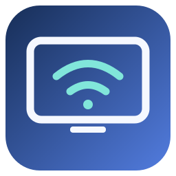
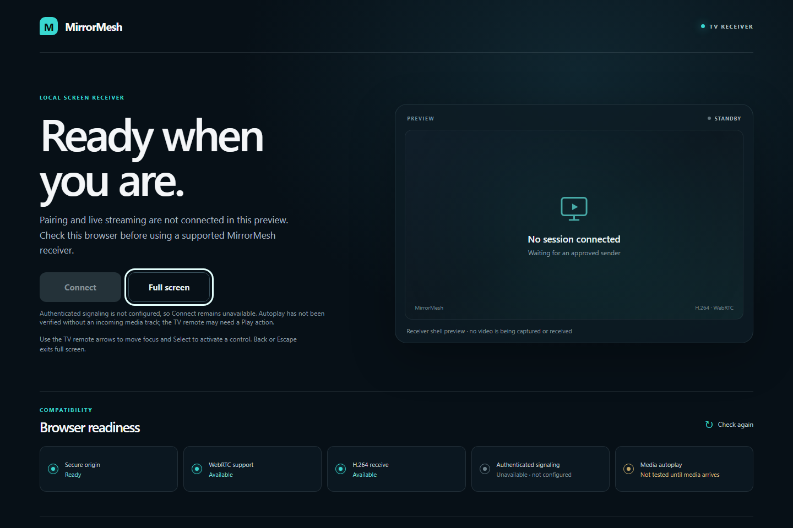
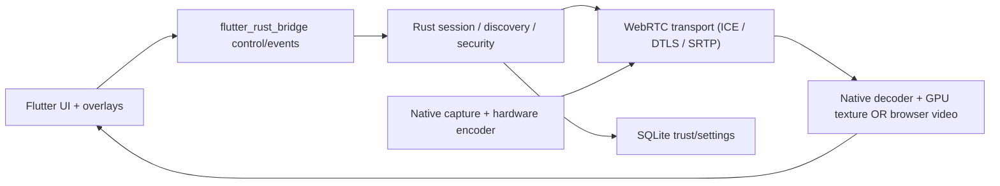

<p align="center">
  
</p>
<h1 align="center">MirrorMesh</h1>
<p align="center"><strong>Cross-platform, low-latency screen sharing with annotation and TV casting.</strong></p>
<p align="center">
  
  
  
  
  
  
</p>
<p align="center">
  
  
  
  
</p>

> **Status: implementation scaffold; not a working mirroring product.** The Rust workspace has a strict bounded JSON protocol parser, a v1 golden offer fixture, domain/session types, ports, scoped consent, preferences storage, runtime, state-only FFI DTOs, and generated Flutter Rust Bridge bindings. Rust format/check/Clippy/tests pass. A test-only pairing coordinator now connects QR invitation and nonce handling to a signed-proof identity port and explicit grant approval; a stateless Ed25519 verifier candidate and an `mm-store::SqliteTrustedPeers` adapter now exist; the generic `mm-runtime::PairingRuntime` composes the coordinator with local identity and trusted-peer ports, and integration tests exercise it with the real verifier and SQLite store; concrete platform adapter assembly into app startup remains open. Windows Credential Manager and Linux Secret Service identity candidates exist in `mm-adapter-win` and `mm-adapter-linux`; both have fake-store tests, while real OS key-store access remains unverified. The Linux adapter compiles for `x86_64-unknown-linux-gnu` under Rust 1.85 and 1.99, but has not been exercised against a live Secret Service. Android/iOS key stores and QR UI remain open. The shared `mm-adapter-discovery` candidate browses MirrorMesh mDNS, validates service metadata, and preserves unauthenticated IPv4/IPv6 socket endpoints through an application discovery coordinator; duplicate claimed IDs and the local device are filtered. It is not connected to app startup and has not been tested on a LAN. `mm-security::PairingAttemptLimiter` adds a proposed in-memory per-source admission policy, pending security review and signaling-listener integration. The Flutter four-tab shell passes analysis/widget tests and compiles for Windows; its Windows build packages the Rust state library and displays the state-only session view. Flutter demo scan, pairing-start and end actions now use narrow Rust session commands; native integration coverage verifies the safe `Idle → Discovered → Pairing → Stopped` path. This remains a labeled local demo: it does not verify a peer, use the network, request capture, or stream media. The annotation preview uses a synthetic no-frame placeholder and screenshot export remains disabled. Native media adapters are not connected. Linux and Android ARM64 library packaging and iOS device static linking with a Dart FFI export list are configured but not yet verified on their platform runners; the iOS simulator bridge remains unavailable. The TV browser has a tested capability/status shell. The native Android TV project has static source checks but has not been built. Authenticated signaling, production transport, media decoding, and hardware validation remain unimplemented. The SVG is an original placeholder icon, not a screenshot. See `docs/verification.md` for evidence and limits.

The pairing runtime reserves a per-source attempt before parsing/verifying the completed `pair.begin` payload and keeps the source address attached through explicit approval. Task 19 adds a bounded native WSS listener candidate and a two-process loopback exchange, but no platform app or user approval UI assembles it yet.

A native Rustls TLS 1.3 raw-public-key pinning candidate binds the receiver’s presented Ed25519 key to the pairing QR fingerprint. Task 19 uses it in a local WSS listener test, and Task 20 adds a Windows TLS signing adapter with fake-store tests. No live Credential Manager entry or app startup uses it yet. Browser WSS still requires a normally trusted HTTPS endpoint.

## Vision

Mirror a computer, phone or tablet to another supported device on an authorized LAN connection; control the session, take immediate snapshots, annotate over received video, and display it on TVs with a supported receiver. Work offline on supported native receivers, with an optional online HTTPS service for TV browser pairing.

## Delivery targets and honest status

**Decision MM-PLAN-001:** All four installed platforms start engineering **in parallel**; the native Android TV receiver is the **primary** TV sink; TV browser is a **capability-gated fallback**. No complete app or passing hardware test exists yet.

| Parallel track | Planned installation | Intended roles | Readiness |
|---|---|---|---|
| Windows x64 | MSIX / signed installer | send + receive | Flutter shell compiles; no capture/transport adapter |
| Linux x64 | `.deb` / AppImage | send + receive | Flutter shell source; platform build not run |
| Android ARM64 phone/tablet | APK / AAB | send + receive | Flutter shell source; Android build not run |
| iOS/iPadOS ARM64 | signed IPA / TestFlight | send + receive **subject to OS API availability** | Flutter shell source; iOS build not run |
| **Android TV / Google TV** | dedicated native receiver APK | **receive (primary TV path)** | source shell only; not built |
| Smart TV browser | HTTPS/WebRTC receiver web app | **fallback candidate; receiver flow disabled** | TypeScript capability shell; 7 Node tests pass; Edge 155 desktop localhost smoke; no TV/device test |

### TV browser shell preview



This is a desktop browser screenshot of the capability shell. It does not show an Android TV browser, authenticated session, or received video.

**Integration target:** each usable sender must connect to Android TV *and* at least one desktop; each native receiver must accept at least one known sender. Windows, Linux, Android, iOS, TV native and web teams progress concurrently after a short shared protocol/interface gate. More pathways are certified individually, not implied. The Apple iOS ScreenCaptureKit sample currently requires iOS 27+; older versions have a separate feasibility test.

**Future experiments:** Google Cast, Miracast, AirPlay, Linux-phone/PSP compatibility. Unsupported: universal Smart TV mirroring, protected media capture, unauthorized input/control or invisible background recording.

## Quick navigation

1. [Product/architecture SPEC](docs/SPEC-001-mirrormesh.md)
2. [Codex execution orders](codex/README.md) and [agent contract](AGENTS.md)
3. [Reference app REA investigation SOP](docs/research/airmirroring-rea.md)
4. [Device compatibility and TV strategy](docs/device-matrix.md)
5. [Wire protocol and schemas](docs/protocol.md)
6. [Shared glossary](docs/GLOSSARY.md)
7. [Agent skills catalog](docs/skills.md)
8. [Feature backlog and UI](docs/features-ui.md)
9. [Parallel implementation and six workstreams](docs/implementation.md)
10. [Build, releases and CI](docs/build-release.md)
11. [Security, legal/clean-room process](docs/security-legal.md)
12. [Testing and metrics](docs/verification.md)
13. [Architecture choices](docs/adr/0001-rust-flutter-webRTC.md), [transport spike status](docs/adr/0002-transport-spike.md), [approved parallel-plan ADR](docs/adr/0003-parallel-targets-android-tv-primary.md), [trusted-peer record ADR](docs/adr/0004-trusted-peer-records.md), [SQLite store ADR](docs/adr/0005-sqlite-trusted-peer-store.md), [pairing coordinator contract ADR](docs/adr/0006-pairing-coordinator-proof-contract.md), [Ed25519 identity candidate ADR](docs/adr/0007-ed25519-identity-candidate.md), [Windows identity key storage ADR](docs/adr/0009-windows-identity-key-storage.md), [pairing runtime composition ADR](docs/adr/0010-pairing-runtime-composition.md), [source-aware runtime admission ADR](docs/adr/0016-pairing-runtime-admission-candidate.md)
14. [Source references / API checks](docs/sources.md)
15. [Contributing](CONTRIBUTING.md) and [security reporting](SECURITY.md)

## Quick start (verified Rust source scaffold)

```bash
# Install Rust 1.99.1 with the MSVC target and Visual Studio C++ Build Tools.
cargo fmt --all -- --check
cargo check --workspace --all-targets
cargo clippy --workspace --all-targets -- -D warnings
cargo test --workspace

# TV browser capability shell (TypeScript build plus Node.js checks):
cd apps/tv-web
npm ci
npm test

# Flutter interface checks:
cd ../mirrormesh_flutter
flutter pub get
dart format --output=none --set-exit-if-changed lib test
flutter analyze
flutter test
```

On Windows, run the Rust commands from a Visual Studio developer shell so `link.exe` and Windows SDK libraries are configured. Rust and Flutter checks passed on 2026-10-18; a Windows Flutter shell build also completed. The Flutter test/build outputs were produced from a temporary copy because this session could not create Flutter's ignored `build/` directory inside the workspace. Android TV, Linux, Android phone, and iOS native builds are not yet verified; see `docs/verification.md`.

## Installation and building the current shell

No installable release or signed package is available yet. For a local Windows build, use Flutter 3.47.7 stable, Dart 3.13.5, Rust/Cargo 1.99.1 with the `x86_64-pc-windows-msvc` target, and Visual Studio C++ Build Tools with the Windows SDK. The verified command builds the control shell and bundles the Rust state library; it does not enable screen capture or streaming:

```powershell
cd apps/mirrormesh_flutter
flutter pub get
flutter build windows --release
```

After a successful build, launch `apps/mirrormesh_flutter/build/windows/x64/runner/Release/mirrormesh_flutter.exe`.

The browser capability shell can be compiled and checked with Node.js 20 or later:

```sh
cd apps/tv-web
npm ci
npm test
```

The Android TV project currently has source and local state checks only. Its Gradle/APK build and device installation have not been verified. Platform build commands and exact toolchain requirements are tracked in [Build, releases and CI](docs/build-release.md) and [verification](docs/verification.md).

## Troubleshooting

- **Rust state bridge unavailable:** Windows loads `mm_ffi.dll` beside the executable. Rebuild the Windows app with Cargo available on `PATH`; the CMake build compiles and stages the DLL. The app keeps the demo local if the library cannot load.
- **Native Flutter bridge test is skipped:** set `MIRRORMESH_FFI_LIBRARY` to the built platform library before running `flutter test --no-pub test/rust_bridge_test.dart`. The test only runs on Windows/Linux when that variable is set.
- **Windows Rust build cannot find the linker or Windows SDK:** open a Visual Studio developer shell with the C++ desktop workload and Windows SDK installed.
- **TV web checks cannot find `tsc`:** use Node.js 20 or newer and run `npm ci` from `apps/tv-web` before `npm test`.
- **Android TV build tools are missing:** the repository currently has source checks and a Java state harness, not a verified APK build. See the Android TV verification row before treating it as installable.

## Architecture at a glance



Raw frames/PCM must **not** be copied through Dart event streams. Bind native GPU surfaces or render decoded browser video directly. The Rust/WebRTC integration and native packaging remain research spikes with explicit go/no-go gates. The **Android TV native APK is the primary TV receiver**; the TV web receiver is a separate fallback only for compatible secure-origin/WebRTC browsers. Both receiver shells exist; neither currently streams media.

## Repository standards

- Document every feature as **implemented / experimental / planned / unavailable** with test evidence; do not list wishlist features as shipping.
- Keep clean-room REA outputs separated from product code; never commit copyrighted third-party binaries.
- Each PR: scope, affected module, linked requirement, tests with commands and outputs, screenshots where UI changes, security consequences, rollback.
- Each release: executable checksums, SBOM, source tag, changelog, signed artifacts where supported.
- Add real demo GIF and `docs/assets/app-preview.png` after UI is built; optimize image and add descriptive alt text.
- Publish architecture ADRs, benchmark methodology, verified compatibility matrix, and limitations to make the portfolio credible.

## Security and privacy

The demo does not read the screen, contact another device, or transmit media. Its Pairing label reflects a local state-machine transition; no peer identity has been verified. Production pairing, authenticated signaling, capture, and media transport are not implemented, so do not use this scaffold for sensitive screen sharing. Real capture must use explicit operating-system consent, and unattended recording is not allowed. See the [security and privacy model](docs/security-legal.md) and [vulnerability reporting policy](SECURITY.md).

## Performance methodology

No FPS, bitrate, latency, hardware codec, or end-to-end performance result is claimed. The [verification plan](docs/verification.md#measurement-method) describes timestamping, external-camera latency measurement, sample counts, and per-device reporting. Populate results only from named hardware fixtures; do not substitute mock runs for media benchmarks.

## Roadmap

Task 02 software work is in progress: the Rust workspace has bounded WebRTC session/ICE controls, reconnect and RTP timing primitives, a bounded encoded-frame queue, and a synthetic I420 source. The Flutter app now pins `flutter_webrtc` and includes a fake-tested, metadata-only engine adapter. ADR-0002 selects libwebrtc for platform integration. The native plugin build is still blocked by Windows plugin symlink support; authenticated signaling, real H.264 encoding, rendering and interoperability remain open. Physical-device testing is deferred while code work continues. See the [transport status report](docs/spikes/transport-experiment-blocker.md), [Task 02 brief](codex/02-transport-spike.md), and [implementation status ledger](docs/IMPLEMENTATION_STATUS.md). Follow-on work covers production identity and consent, native platform adapters, rendering and snapshots, hosted quality gates, and sender-to-TV integration. The [implementation roadmap](docs/implementation.md) and [task board](codex/README.md) track those workstreams. No platform is listed as supported until its device path passes the documented gates.

## License

**Undecided.** Do not publish application source under an assumed license. Decide permissive vs reciprocal licensing after checking media-library licenses and any reference-app interoperability work. Research documents may be published only if they contain original text and lawfully shareable evidence.

## Professional architecture help

[**sammuti.com**](https://sammuti.com)
