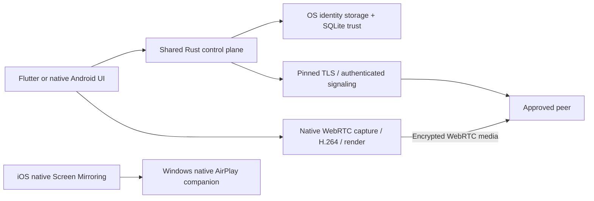

# Architecture and workspace map

## Two native applications, one shared control plane

`apps/mirrormesh_flutter` supplies the desktop/iOS interface and native platform hosts.
`apps/android-tv` supplies the canonical Android phone/TV APKs. Both reuse the Rust
identity, pairing, signaling, trusted-peer and session components. There is no cloud
account or separate protocol per platform.

Media stays inside native adapters/libwebrtc; Dart/FFI carries bounded control metadata,
SDP/ICE, state and diagnostics, never raw audio/video frames. The AirPlay companion is
a separate native pipeline and does not weaken MirrorMesh TLS authentication.

## Rust crate responsibilities

| Crate(s) | Responsibility |
| --- | --- |
| `mm-domain` | Device/session IDs, fingerprints, reported device facts, grants and lifecycle types |
| `mm-ports` | Storage, identity, transport and platform boundaries |
| `mm-application`, `mm-runtime` | Pairing/session coordination, validation and runtime composition |
| `mm-protocol`, `mm-security` | Bounded wire messages, proof encoding, invitation/nonce/admission rules |
| `mm-adapter-identity`, `mm-adapter-tls` | Ed25519 identity and TLS 1.3 peer pinning |
| `mm-adapter-signaling`, `mm-adapter-discovery` | Approved WSS commands and local DNS-SD hints |
| `mm-store` | SQLite public trusted-peer persistence; no private identity seed |
| `mm-adapter-win/linux/android/ios` | OS storage/runtime integration; Apple adapter reused by macOS |
| `mm-transport` | Retained native transport abstraction; media execution remains in libwebrtc |
| `mm-ffi` | Dart/native/JNI control surfaces, metadata JSON commands and generated bridge |

All 17 workspace crates and their dependency locks remain. Avoid removing an apparently
small adapter without checking the workspace's target-dependent dependency graph.

## Platform source paths and products

| Target | UI/native entry points | Build path | Product |
| --- | --- | --- | --- |
| Windows x64 | Flutter `lib/`; `windows/runner/`; `mm-adapter-win` | `scripts/build-windows.ps1` | Complete EXE/DLL/assets ZIP |
| Android phone | `apps/android-tv/app/src/main/`; phone flavor; Rust JNI | `scripts/build-android.ps1` | Phone APK |
| Android TV | Same Java/WebRTC/JNI source; TV launcher/flavor | Same script | TV APK |
| Linux x64 | Flutter `lib/`; GTK `linux/runner/`; `mm-adapter-linux` | `build-linux.sh` or Docker wrapper | Complete GTK/Flutter/shared-library tarball |
| macOS | Flutter `lib/`; Swift `macos/Runner/`; shared Apple adapter | `build-macos.sh` | Intended universal .app ZIP; unbuilt here |
| iOS | Swift `ios/Runner/`, ReplayKit `BroadcastExtension/`; Apple adapter | Xcode + `ios/scripts/` | Intended signed app/IPA; unbuilt here |

The Android TV flavor uses the same MediaProjection sender where its OS permits capture.
The Flutter desktop session classes retain historical `Windows*` names but route Linux/macOS
commands through the same Rust session machinery. No duplicate session engine is introduced.

### Important code entry points

- Flutter `lib/app.dart`: desktop connect/search/send; `receive_screen_page.dart`: receive/approval/video.
- `windows_sender_session.dart`, `windows_pairing_bootstrap.dart`, `webrtc_engine.dart`: sender lifecycle and native WebRTC.
- `native_connection.dart`, `device_context.dart`, `network_devices.dart`: bounded Rust commands, public device facts, discovery.
- Windows `receiver_host.cpp`, `native_casting.cpp`: native AirPlay ownership and read-only OS Miracast status/handoff.
- Android `MainActivity`, `TvVideoActivity`, `TvWebRtcReceiver`: native receive/approval/render flow.
- Android `SenderActivity`, `ScreenSenderService`: explicit MediaProjection capture, WebRTC and cleanup.
- Rust `mm-ffi/src/native_platform.rs`, `native_receiver.rs`, `connection_command.rs`: shared per-platform composition.

## Connection lifecycle

1. User starts the receiver; it selects one active physical LAN interface and advertises a hint.
2. Sender chooses a device or current invitation. QR pairing pins identity; discovered-device
   requests use the explicit comparison/approval flow. Discovery alone grants no trust.
3. Rust verifies bounded signed proof/device facts, expiry, nonce and transport identity.
4. Receiver reviews the request and explicitly grants view access. OS capture permission
   and source selection are still required on the sender.
5. Approved signaling exchanges SDP/ICE; native WebRTC carries encrypted media.
6. Stop/reject/revoke, startup failure and bounded reconnect failures release capture,
   peers, channels, listeners and owned native processes. Revocation persists separately.

## Workspace and release boundaries

- `apps/`, `crates/`, pinned manifests, `scripts/` and current guides are build inputs.
- `releases/` holds generated local products, public checksums and folder descriptions.
- `.toolchains/`, `target/`, per-app `build/` and native ephemeral folders are ignored caches.
- Personal extracted bundles remain ignored/local; never package their runtime keys or trust state.
- `session-context.md` is a concise sanitized maintenance checkpoint, not a build input.
- Historical reports, obsolete Android shell and browser prototype are preserved at
  `test_6` commit `4052f40`; they are not current release products.

Current integration decisions are in `docs/adr/0055` through `0062` documents. Older design
ADRs referenced by number in source comments are available in the checkpoint's Git history.
The [original specification](SPEC-001-mirrormesh.md) is broader future scope, not a readiness claim.

See [build/release procedure](build-release.md), [protocol](protocol.md),
[security/storage](security-legal.md) and [readiness](IMPLEMENTATION_STATUS.md).
