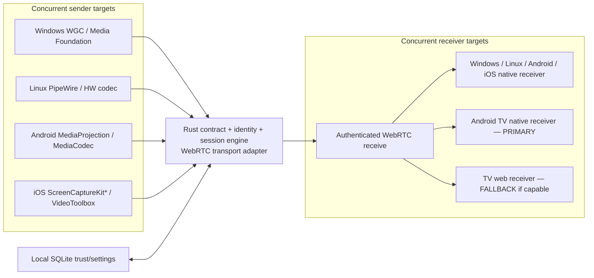
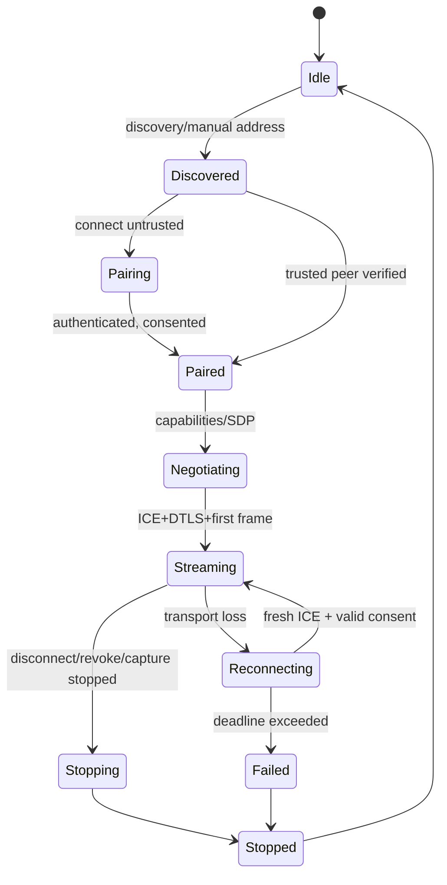

# SPEC-001-MirrorMesh: Universal Low-Latency Mirroring

**Status:** Architecture priorities confirmed; implementation unstarted • **Updated:** 2026-10-18 • **Working title:** MirrorMesh
**Decision MM-PLAN-001:** Begin Windows, Linux, Android, and iOS engineering **in parallel** after a short shared contract gate. Make the **native Android TV receiver the primary TV target**, with a **WebRTC TV browser receiver as best-effort fallback**. These are development priorities, not claims of tested compatibility.

## Background

The reference Microsoft Store listing **AirMirroring – Screen Mirroring & Cast** (`9P2K9G20SWZ6`) describes receiving iPhone/iPad/Mac screens on Windows. Its internal protocol/feature list has **not** been inspected; do not describe conjectures as REA findings. We seek a clean-room, separately implemented, cross-platform open-source counterpart that additionally sends PC/phone screens to TVs, captures receiver screenshots, and provides non-invasive annotation. Minimize interactive latency without assuming Rust alone is sufficient.

## Requirements

IDs are stable for tasks, tests, and PRs. All requirements demand explicit on-screen consent for capture and pairing.

### Must have (M)
- **M-01 (expanded):** Windows x64, Linux x64, Android ARM64 and iOS/iPadOS ARM64 application workstreams start **in parallel**. Each targets a sender **and** receiver with consented capture/playback and a GUI to discover, pair, connect, disconnect and diagnose sessions; platform/API restrictions must be surfaced accurately rather than bypassed.
- **M-02:** Encrypted LAN media for owned/authorized devices using browser-interoperable H.264/WebRTC and OS hardware capture/encoding when available.
- **M-03 (expanded):** Cross-platform E2E acceptance: every shipping sender must stream to a verified desktop receiver **and** an Android TV receiver; every shipping native receiver must accept at least one test sender. Publish individually tested source→destination paths rather than claiming a fully connected all-to-all matrix.
- **M-04:** User-triggered screenshot of current received frame to local PNG with optional annotations; no silent storage.
- **M-05:** Receiver-side doodling, undo/clear, pen color/size and pause/freeze frame across supported receiver UIs.
- **M-06:** No unapproved remote input, recording, pairing, persistent trust, or auto-stream startup; encrypted control/media, consent scope, expiry and revocation. Before transport starts, the runtime must ensure the operation's requested grant scope is covered by the peer's persisted approval.
- **M-07:** Rust shared core with capture/codec seams, bounded frame queues, timestamped metrics and strict no-pixel-frames-in-Dart boundary.
- **M-08 (expanded):** CI compile/test jobs and **separate packaging pipelines** for Windows x64, Linux x64, Android APK/AAB and iOS TestFlight/IPA, with hardware/security evidence and per-platform release gates.
- **M-09 (new):** **Primary TV endpoint:** installable Android TV/Google TV receiver app using native decode + D-pad UI. **Fallback:** browser receiver with authenticated HTTPS/WSS signaling and capability checks. Fallback only on TVs whose browsers pass a tested compatibility matrix; no universal guarantee.
- **M-10 (new):** A frozen versioned protocol/FFI contract, fake adapters and shared golden fixtures **before** six concurrent tracks: Windows, Linux, Android phone/tablet, iOS/iPadOS, Android TV receiver, and TV browser receiver. Separate agents/branches/owned paths; integrate continuously.

### Should have (S)
- **S-01 (re-scoped):** Linux Wayland GNOME/KDE portal + PipeWire support and tested X11 contingency; hardware encode with documented fallback.
- **S-02 (re-scoped):** Android phone/tablet MediaProjection lifecycle hardening, rotation/background behavior and robust MediaCodec implementations on diverse devices.
- **S-03:** 1080p60 low-latency profile on compatible GPUs/SoCs, adaptive 720p30 and opt-in audio.
- **S-04:** QR pairing, manual address/DNS fallback, reconnection that never silently restarts capture.
- **S-05:** Multi-monitor/window selection, quality selector and sender-side session diagnostics.
- **S-06 (re-scoped):** Expanded TV-browser compatibility, offline/on-LAN secure-origin strategy where supported, and remote-navigation UX. Browser fallback baseline itself is **M-09**, not deferred.
- **S-07 (new):** Automated protocol/golden-fixture tests across every sender/receiver adapter and at least one physical cross-OS receiver test per shipping platform.

### Could have (C)
- **C-01 (re-scoped):** iOS support below the verified ScreenCaptureKit deployment baseline **only** after a signed API/version/App-Review spike; investigate ReplayKit legacy behavior as a constrained fallback, not an assumed capability. **Current iOS capture work is M-01.**
- **C-02:** Google Cast custom receiver, Miracast system delegation, and clean-room AirPlay interoperability where legal/feasible.
- **C-03:** Annotated exports, separately consented recording/rolling buffer and optional laser pointer.
- **C-04:** Multi-view, session invitation, TURN relay, presenter mode, watermark and expanded diagnostics.
- **C-05:** Linux phones, PSP homebrew/HDMI capture alternatives.

### Won't have in MVP (W)
- **W-01:** Guaranteed arbitrary-TV, stock-PSP, console or DRM-protected capture or mirroring.
- **W-02:** Unattended capture, unauthorized remote control, cloud frame storage or unauthenticated socket exposure.
- **W-03:** Decompiled-source reuse, circumvention of proprietary receiver protections.
- **W-04:** Treating a build artifact or emulator success as proof of functional, hardware-verified release support.

**Scope note:** The historical S-01 (Linux), S-02 (Android), and C-01 (iOS) launch work is **promoted into M-01** by MM-PLAN-001; their existing IDs now cover additional maturity/legacy work. App Store availability is gated by Apple's documented capture APIs and user approvals; an iOS build may initially expose receiver-only mode or show an explicit unsupported-OS state. All platform teams still start on day one.

## Method

### Architecture



`*` iOS system capture requires a verified OS/API baseline and user picker; current Apple sample requires iOS 27+. Older OS support is a feasibility track, not a promise.

**Layering:** `domain` pure state, `application` use cases, `ports` capture/codec/discovery/signaling/clock/storage interfaces, `adapters` platform implementations, `ffi` narrow control/event bridge to Flutter, `apps` Flutter desktop/phone shell, Kotlin/Android TV receiver shell, and web fallback. **All platform workstreams use one protocol v1, shared fixtures, and capability flags.** Native media frames never travel through Dart.

**Preflight gate:** Evaluate Rust `str0m`, GStreamer `webrtcbin`, and libwebrtc against H.264, browser interop and mobile packaging in ADR-0002. Platform teams may independently develop consent UI, native capture/decoder shims and fake-media integration **while this spike runs**; shipping media integration waits for the selected transport contract. Rust is the common orchestration layer; OS APIs own codec/GPU surfaces.

**Connection flow:** Advertise `_mirrormesh._tcp.local` (version, device roles, H.264/Opus capabilities; no secrets) → choose target (prefer Android TV app; show TV browser option only if feature-detected) → QR with receiver fingerprint and expiring one-time pairing secret → explicit owner approval → authenticated signaling + SDP/ICE/codec negotiation → DTLS/SRTP → native or browser decoder → controlled disconnect. If a six-digit pairing code is added, use an audited PAKE rather than plain PIN authentication. TV browser launch may require an HTTPS-hosted receiver/broker; local insecure origins cannot be presumed interoperable.

**Network behavior:** mDNS and optional BLE serve discovery/pairing **only**; WebRTC carries the stream, usually over UDP, with configurable authenticated WSS signaling (default TCP 8765). Do not open router ports or enable UPnP without a separate consent/architecture decision. Fallback means an **alternative receiver application**, not automatic Google Cast/Miracast interoperability.

### Concurrent ownership / integration rules

| Track | Owned implementation surfaces | First functional demo |
|---|---|---|
| WIN | `crates/mm-adapter-win/`, Windows runner/packaging | Win sender→Android TV, Win native receiver |
| LNX | `crates/mm-adapter-linux/`, Linux runner/packaging | Wayland sender→Android TV, Linux receiver |
| AND | `crates/mm-adapter-android/`, Android phone shell | Phone sender→Android TV, phone receiver |
| IOS | `crates/mm-adapter-ios/`, iOS shell / Xcode | iOS sender→Android TV if API gate passes; native receive fallback independently |
| TV | `apps/android-tv/`, TV decoding and D-pad navigation | Receive a known H.264 test sender |
| WEB | `apps/tv-web/`, browser feature detection/HTTPS | Receive the same authenticated stream on known supported browser |

Shared crates and `docs/protocol.md` are owned by a designated integrator; changes require review across affected tracks. PRs from different tracks can run simultaneously **after** the protocol/FFI fixture gate; each has isolated files, feature flags, and a hardware evidence checklist. CI merges against main daily, not only at final release.

### Domain and contracts

See [protocol.md](protocol.md) for exact JSON messages, storage migration, state transitions and traits. Key data structures:

```rust
pub struct DeviceId(pub uuid::Uuid);
pub struct SessionId(pub uuid::Uuid);
pub enum Role { Sender, Receiver }
pub enum SessionState {
    Idle, Discovered, Pairing, Paired, Negotiating, Streaming,
    Reconnecting, Stopping, Stopped, Failed
}
pub struct CaptureConfig {
    pub source: CaptureSource,
    pub max_width: u32,
    pub max_height: u32,
    pub target_fps: u16,
    pub video_kbps: u32,
    pub include_audio: bool,
}
pub trait CaptureSourcePort: Send {
    fn start(&mut self, cfg: CaptureConfig) -> Result<(), CaptureError>;
    fn stop(&mut self) -> Result<(), CaptureError>;
}
```

Synchronous example only; final callback/thread and GPU handle contract must be chosen in Task 02. Capture adapters MUST NOT be called from networking/reactor event loops.

### Session machine



### Database (local SQLite)

- `schema_migrations(version INTEGER PRIMARY KEY, applied_at TEXT NOT NULL)`
- `local_identity(device_id TEXT PRIMARY KEY, public_key BLOB NOT NULL, key_ref TEXT NOT NULL, created_at TEXT NOT NULL)` — private key only OS secure storage; `key_ref` opaque.
- `trusted_peers(device_id TEXT PRIMARY KEY, display_name TEXT NOT NULL, public_key BLOB NOT NULL, fingerprint TEXT NOT NULL, grants_json TEXT NOT NULL, paired_at TEXT NOT NULL, last_seen_at TEXT, revoked_at TEXT, UNIQUE(fingerprint))` — validate grants to `{view,send,annotate}` before use.
- `session_history(id TEXT PRIMARY KEY, peer_id TEXT NOT NULL, local_role TEXT NOT NULL, started_at TEXT NOT NULL, ended_at TEXT, result TEXT, stats_json TEXT, FOREIGN KEY(peer_id) REFERENCES trusted_peers(device_id))` — no content frames.
- `preferences(key TEXT PRIMARY KEY, value_json TEXT NOT NULL, updated_at TEXT NOT NULL)`.
- `annotation_exports(id TEXT PRIMARY KEY, session_id TEXT, path TEXT NOT NULL, created_at TEXT NOT NULL, include_annotations INTEGER NOT NULL)` — local-only; no deleted-session FK.
- Foreign keys on; migrations transactional; WAL for desktop only after platform checks; restrictive filesystem permissions. No raw pairing secrets in SQLite.

### Annotation algorithm

1. Convert pointer coordinate `(x,y)` to normalized video-area `(u,v)`, excluding letterbox bars and accounting for rotation/mirror transform.
2. Emit `StrokeStart(id,color,width_px,display_transform_version)` and timestamped `StrokePoint(id,u,v,dt_ms)` (bounded 1–240 points/s); never ship unbounded arbitrary geometry.
3. Render independently on GPU overlay; optional remote sync over reliable WebRTC data channel only for separately granted `annotate`.
4. Store only explicit saved exports; `undo` pops last local stroke, `clear` empties overlay; screenshot takes decoded frame + optional composed overlay after the same presentation fence.
5. On resize, recalculate transforms but preserve normalized coordinates. On Disconnect, purge ephemeral strokes unless user exports.

### Latency strategy and measurement

Use GPU surfaces, HW H.264, 1-2 outstanding frames, 0 B-frames, minimum decoder jitter consistent with stable viewing, no Dart frame serialization. For overflow drop oldest unencoded frames and request keyframe if decoder recovery needed; never grow memory queue. Compare `capture→encode`, `encode→arrival`, `arrival→present` with monotonic timestamps **within each host**; estimate end-to-end **only** with synchronized clocks or external high-speed camera/LED test. Initial goals under compatible local Wi-Fi 5/6 conditions: 1080p60 *where supported*, input-to-photon p95 ≤150 ms; first frame ≤3s after confirmed connection; no unsupported guarantee. Keep raw per-device baselines.

## Implementation

Current source organization is described in [the architecture map](ARCHITECTURE.md)
and [the build guide](build-release.md). Historical task briefs remain in Git history.
The original phases below are design scope, not the current release's completion claim.

1. **P0:** REA/evidence, lawful analysis gate, security model, verify OS APIs and Android TV/browser capabilities.
2. **P1:** In parallel, scaffold **all six** targets using fake capture/decoder while core owner locks protocol v1, Rust ports, session state and ADR-0002 transport preflight.
3. **P2:** Execute Windows, Linux, Android, iOS, Android TV and web browser tracks **concurrently** using isolated PRs; CI builds each target continuously.
4. **P3:** Integrate pairing, user consent, screenshots/doodle UX and cross-device H.264 scenarios. Native Android TV is primary; TV browser fallback only on an explicitly tested model/version.
5. **P4:** Package/benchmark/install **all four app platforms in parallel**; run platform-specific release gates, maintain the known-compatible device matrix.
6. **P5:** Publish a single project release milestone/report; create downloadable binaries and store/TestFlight entries **only for gates actually passed**, and label unfinished targets experimental/blocked.

### Milestones (indicative; parallel staffing assumption: 5–7 technical owners plus real test devices)

| Gate | Relative planning window | Exit condition |
|---|---|---|
| **P0 — Evidence** | weeks 1–2 | Authorized REA report, API/restriction checks, legal/security sign-off |
| **P1 — Shared contract and six scaffolds** | weeks 1–3 (overlaps P0) | Versioned v1 schema, fake-frame fixtures, locked API/FFI ports, Windows/Linux/Android/iOS/TV/web compile or explicit documented SDK block |
| **P2-WIN / P2-LNX / P2-AND / P2-IOS / P2-TV / P2-WEB** | weeks 3–9 **concurrently** | Each native adapter/receiver reaches its local spike exit gate; TV native receiver interoperates with fake/known sender; browser negotiates H.264 on a tested TV browser |
| **P3 — Cross-platform convergence** | weeks 8–12 | Every intended shipping sender→Android TV + desktop receiver tested; native receivers take a known sender; tools/pairing/consent/security tests |
| **P4 — Platform release candidates** | weeks 11–16 | WIN MSIX/exe, LNX `.deb`/AppImage, AND phone APK/AAB + Android TV APK, IOS TestFlight/IPA candidate each separately installed/tested |
| **P5 — Evidence-backed public release** | weeks 15–20 | Per-platform release gates individually green; compatibility matrix and measured latency published; unsupported targets withheld or marked pre-release |
| **P6 — Extended protocol research** | after P5 | Cast/Miracast/AirPlay/PSP spikes under separate ADRs; not blockers for P5 |

The periods are estimates, **not** a four-platform delivery guarantee. Missing Apple API availability, TV browser capability, signing or hardware means that track records `BLOCKED` with evidence while other tracks continue; do not silently downgrade the parallel priority or ship untested builds. See `docs/implementation.md` for branch ownership, test scenarios and blockers.

## Gathering Results

Measure on documented GPU/CPU/OS/network fixture: paired success %, discovery latency, time-to-first-frame, capture/encode/decode/presentation timings, p50/p95 externally-measured latency, FPS dropped-frame ratio, CPU/GPU %, battery, reconnect time, sessions ended cleanly, crash-free minutes and memory growth over 60 min. Maintain `docs/verification.md` and device matrix; release only when acceptance tests verified.

## Need Professional Help in Developing Your Architecture?

Please contact me at [sammuti.com](https://sammuti.com) :)
