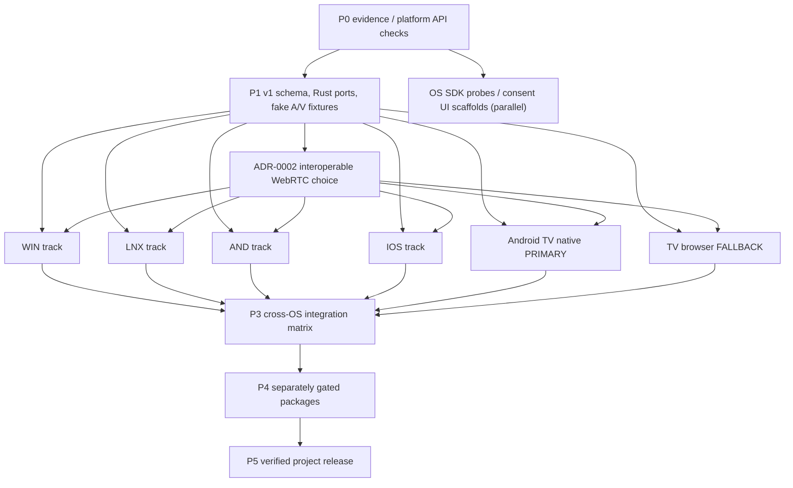

# Implementation roadmap — concurrent platform program (MM-PLAN-001)

## Task 25 Android explicit-action runtime assembly (2026-10-19)

The Android phone app now opens `AndroidPairingIdentity` and `SqliteTrustedPeers` only after the user presses **Prepare pairing support**. JNI creates one process-owned `PairingRuntime`, stored beneath `noBackupFilesDir`, and returns a stable local UUIDv8 derived from the public-key fingerprint. The action opens local state only: it does not discover or contact peers, grant trust, request capture, or stream. Proposed [ADR-0030](adr/0030-android-pairing-runtime-assembly.md) records the assembly and its limits. Host Rust and Flutter gates pass; Android ARM64 compilation stops in `dart-sys` because NDK clang is unavailable, so no APK or device behavior is verified.

## Task 24 runtime ownership update (2026-10-19)

`PairingCoordinator`, `PairingRuntime`, `TrustedSessionRuntime`, and `MirrorMeshRuntime` now own shared identity/store ports through `Arc`, so a platform owner can retain one runtime across listener callbacks. The composed facade shares the same peer-store instance for pairing and trusted-session operations. The public API candidate and concurrency limits are recorded in [ADR-0029](adr/0029-owned-pairing-runtime-state.md). Task 25 now assembles the Android identity and SQLite store into this runtime only after the user explicitly starts pairing; no Android SDK, APK, or device check ran for Task 24.

## Task 03 discovery update (2026-10-18)

CORE has proposed mDNS browser and publisher candidates in `mm-adapter-discovery`, using pinned `mdns-sd 0.21.5`. Browsing is bounded to two seconds; publication accepts explicit caller-supplied identity, local addresses, and metadata and publishes only the candidate v1 TXT schema on port 8765. Twenty-one discovery/publication and endpoint-conversion tests plus three application discovery tests pass on Windows; full workspace formatting, strict Clippy, and tests pass (126 unit tests plus 21 integration tests). GNU/Linux cross-target checks pass on Rust 1.99.1 and 1.85. No test opens sockets or verifies multicast on a LAN. The publisher is not connected to app startup or a user-facing discoverability control. See proposed [ADR-0012](adr/0012-mdns-discovery-candidate.md), [ADR-0013](adr/0013-mdns-service-publication-candidate.md), and [ADR-0014](adr/0014-discovery-candidate-application-boundary.md), plus proposed [ADR-0015](adr/0015-pairing-attempt-limiter-candidate.md) and [ADR-0016](adr/0016-pairing-runtime-admission-candidate.md). Mobile discovery, platform permissions, and cross-track approval remain open.

**Status (2026-10-19):** The Rust workspace includes `mm-transport` bounded SDP/ICE control, session/reconnect state, RTP timestamp conversion, an encoded-frame queue, synthetic I420 source, and metadata-only async WebRTC engine port. Rust formatting, strict Clippy, and all-feature workspace tests pass; current counts are in [verification](verification.md). Tasks 15–17 define a strict candidate `pair.begin` schema, a source-admitted raw-frame path, shared outbound encoding, and sender-side signed-proof creation through the local identity port; proposed ADR-0020–0022 remain pending review. Task 18 adds native Rustls TLS 1.3 raw-public-key pinning under proposed ADR-0023; Task 19 adds a bounded native WSS listener candidate under proposed ADR-0024, including an absolute ten-second initial-message deadline and a two-process loopback pairing test. Task 20 adds a Windows Credential Manager TLS signer candidate under proposed ADR-0025, and Task 21 adds a Linux Secret Service signer candidate under proposed ADR-0026; both use fake-store tests and neither has accessed a live OS credential. The listener and signers are not connected to app startup; the local exchange is not LAN or platform evidence. Browser WSS still requires a normally trusted certificate endpoint. ADR-0002 selects libwebrtc through `flutter_webrtc` for Flutter targets, native Kotlin libwebrtc for Android TV, and browser WebRTC APIs for the fallback. The Flutter WebRTC package is pinned and resolved, and a metadata-only Dart adapter is analyzed and fake-tested; the native plugin build is still blocked by Windows plugin symlink support. No capture permission or media stream has been established. Flutter shell analysis/tests and the Windows shell build have prior pass evidence; the web capability shell has seven passing Node tests and an Edge 155 desktop localhost smoke. The local Flutter demo still follows only `Idle → Discovered → Pairing → Stopped`; shared FFI review remains pending in [ADR-0008](adr/0008-flutter-demo-session-ffi.md). Hardware interoperability remains unverified and is deferred while software implementation continues. See the [Task 02 brief](../codex/02-transport-spike.md), [ADR-0002](adr/0002-transport-spike.md), [transport status report](spikes/transport-experiment-blocker.md), and the [implementation ledger](IMPLEMENTATION_STATUS.md). Linux, Android, iOS and Android TV builds remain unverified.
**Approved priority (2026-10-18):** Windows, Linux, Android, and iOS **start concurrently**. Native Android TV is the **primary** television receiver; the browser receiver is an **optional compatibility fallback**, not universal TV support.

## Delivery model

Use **six technical tracks plus one shared integrator** rather than a Windows-first waterfall. A realistic planning assumption is 5–7 available technical owners/agents and test access to Windows, Wayland Linux, Android phones, iOS devices, Android TV hardware and at least one TV browser. A single developer/Codex instance can work through the tracks in repeated short rounds with the *same priorities*; the dates then extend significantly.

| Track / branch | Owns (no shared-core edits without approval) | Primary fixture | First proven output |
|---|---|---|---|
| CORE (`feat/core-*`) | `crates/mm-{domain,application,ports,protocol,security,runtime,ffi}/`; golden fixtures | all CI runners | stable v1 protocol/state + synthetic sender/receiver |
| WIN (`feat/win-*`) | `crates/mm-adapter-win/`, `apps/mirrormesh_flutter/windows/`, Windows packaging | Win11 x64 GPU PC | physical capture/send, native receive |
| LNX (`feat/linux-*`) | `crates/mm-adapter-linux/`, `apps/mirrormesh_flutter/linux/`, Linux packaging | Wayland GNOME/KDE | PipeWire capture/send, native receive |
| AND (`feat/android-*`) | `crates/mm-adapter-android/`, Flutter Android phone plugin, phone packaging | Android ARM64 phone/tablet | MediaProjection sender, native receiver |
| IOS (`feat/ios-*`) | `crates/mm-adapter-ios/`, Swift plugin, iOS build/signing | physical iPhone/iPad + Mac | supported-OS capture/send and native receive |
| TV (`feat/tv-native-*`) | `apps/android-tv/`, TV native decoder UI | actual Android TV/Google TV | installable D-pad receiver, H264 rendering |
| WEB (`feat/tv-web-*`) | `apps/tv-web/`, browser receiver tests & deploy | actual TV browser + Chromium | feature-gated browser receiving over secure signaling |

**Branch collision rule:** only CORE can change shared DTOs; track owners must propose versioned contract changes through an issue + cross-track review. Each PR uses a single task brief, its own affected paths, and mandatory tests. Rebase against `main` daily; automated mocks mean a missing mobile device never blocks unrelated merges.

## Dependency DAG

The `ADR-0002` edge gates integration with **real WebRTC**, not SDK scaffolding or simulated-media adapter tests; those can proceed concurrently. The WEB and TV tracks use the same signaling/pairing contract but distinct UI/decoder stacks.

## P0 — evidence, security, SDK feasibility (weeks 1–2)

1. Create repository with `AGENTS.md`, CODEOWNERS, issue/PR templates, secure secrets storage and CI skeleton.
2. Obtain affirmative authorization for lawful reference-app analysis. Run [task 00](../codex/00-rea-investigation.md); keep raw proprietary binaries out of project.
3. Verify latest platform SDK details: Windows WGC/Media Foundation; Linux portal/PipeWire; Android MediaProjection foreground services; Apple ScreenCaptureKit deployment and ReplayKit legacy viability.
4. Verify Android TV native receiver app deployment, MediaCodec H264 support and D-pad focus; separately inspect TV browser secure-origin/WebRTC limitations.
5. Document network threat model, role-specific QR pairing, TLS certificate pinning / verified fingerprints, Android TV user approval.
6. Assign physical test devices and develop baseline fixtures. A track without a device starts API/CI/mock work but is marked `BLOCKED` for hardware acceptance.

**P0 gate:** research log with fact/inference/unknown distinctions; OS API table with minimum tested SDK; hardware owners and security threat review.

## P1 — protocol/FFI contract + six project scaffolds (weeks 1–3)

1. CORE creates `Cargo.toml`, shared `mm-domain`, `mm-ports`, `mm-protocol`, `mm-security`, `mm-ffi` plus compiled mock components.
2. Freeze protocol v1 JSON envelopes, authenticated signaling semantics, codec capability/consent negotiation, receiver roles, version rejection and strict message bounds. Schema golden fixtures under `tests/protocol-golden/`.
3. Implement synthetic timestamped H264 test source and fake transport plus bounded media queues; control-state tests for 100 start/stop cycles.
4. CORE and media specialist complete [task 02](../codex/02-transport-spike.md), compare `str0m`/GStreamer/libwebrtc and record ADR-0002 (one chosen path shared by all).
5. All six track owners initialize buildable platform shells + FFI/IPC unit mocks and compile smoke actions in CI. Native captures stay gated behind permissions.
6. Gate shared contract PR before every real-media integration, while SDK/GUI/mock tasks may already be in flight.

**P1 gate:** shared contract CI is authored but not run remotely; Android TV emulator build is outstanding; Flutter Windows shell compiles, Linux bridge packaging is configured but awaits a Linux runner, and Android/iOS builds are not yet run; TV web unit tests pass; iOS macOS/Xcode compile is assigned to CI but unverified here. No platform claims a real stream.

**Current P1 status:** Rust CORE format, check, Clippy, unit tests, and FFI integration tests pass locally. The protocol parser validates the common envelope, v1 message vocabulary, field bounds, known grant names, UUIDs, and per-peer/session monotonic sequence. Golden fixtures cover `session.offer` and the proposed strict `pair.begin` schema; `PairingRuntime::verify_pair_begin_from` reserves source admission before parsing, converts the payload to the application proof, verifies it, and leaves trust pending explicit approval. Sender code can create a validated signed proof with `PairingProof::create_signed`, map its read-only accessors to the shared outbound encoder, and pass it into that receiver path; the helper does not validate QR expiry/fingerprint or authenticate transport. The schema and APIs are proposed in ADR-0020–0022 and not frozen. `mm-security` parses approved numeric IP endpoints, strict QR v1 fields, and OS-random 128-bit one-time pairing nonces with a 120-second local monotonic deadline. `mm-domain` validates trusted-peer records, scoped grants, timestamps, and revocation; `mm-ports` defines storage, identity, capture, codec, control transport and asynchronous WebRTC engine boundaries. `mm-application` composes invitation creation, nonce checks, sender proof creation and receiver verification through the identity port, pending explicit approval, grant-subset validation, and trust persistence through the store port. These coordinator tests use fakes; the `mm-adapter-identity` public-key verifier candidate has six passing RFC 8032 and negative-input tests. `mm-adapter-win` has fourteen fake-store tests for pairing identity lifecycle, canonical proof signing, and TLS CertificateVerify signing; Windows Credential Manager has not been accessed at runtime. `mm-store::SqliteTrustedPeers` has ten persistence tests and is assembled by the Windows, Android, and iOS explicit-action runtimes; Linux assembly remains open. The generic runtime composes local identity and trusted-peer ports and applies source-aware admission to raw frames and typed proofs. The real-verifier/SQLite integration tests use this admitted path and confirm explicit approval remains the persistence boundary. Windows runtime assembly is now behind an explicit action; Linux/SQLite runtime assembly, actual platform key-store use, QR UI, authenticated signaling, DNS resolution, and network connection remain open. Linux, Android, and iOS SQLite builds are unverified. Task 02 adds bounded transport control and a synthetic I420 source; ADR-0002 selects libwebrtc, and the pinned Flutter plugin now has a metadata-only Dart adapter; no peer connection, authenticated signaling, media stream or renderer is integrated. Flutter and TV shells remain local demos. The web shell has seven passing Node tests; Android TV source/static and local approval-state checks pass. Hosted CI and source SBOM generation remain unrun. FFI review is pending in [ADR-0008](adr/0008-flutter-demo-session-ffi.md). Platform builds, signaling, real media and hardware checks remain incomplete.

**Task 27 (S-04) caller expiry gate:** `PendingPairingConnection::approve` is now the shared approval path for the native WSS listener. It consumes the pending value, calls the runtime's expiry and grant checks, persists trust only on success, and returns the live connection only after successful persistence. Expired approval drops the socket and releases its listener slot. Two-process loopback regression coverage exercises both valid and expired approvals; it does not establish a platform UI or LAN behavior. See [ADR-0024](adr/0024-bounded-wss-pairing-listener-candidate.md).

**Task 28 (S-04/M-06) Windows pairing bootstrap:** Windows now assembles one process-retained `PairingRuntime` with `WindowsPairingIdentity` and a SQLite public-peer store at `%LOCALAPPDATA%\MirrorMesh\trusted-peers-v1.sqlite`, only after the explicit Devices action. The Windows method channel returns the public UUIDv8-shaped device ID through a narrow C ABI; the seed, peer records, network services, capture, and frames do not cross it. Host/fake tests, Flutter channel/widget tests, a Windows target Rust build, and direct MSVC compilation pass. The actual Credential Manager call, full Flutter bundle build, WSS, LAN, capture, and hardware paths remain unverified. See [ADR-0032](adr/0032-windows-pairing-runtime-assembly-candidate.md).

## Kickoff workstream status

These statuses describe scaffold and kickoff evidence. **No platform has passed a sender-to-receiver media test.** The next tasks are assigned in the linked task briefs.

| Workstream | Status | Evidence and limitation | Next task |
|---|---|---|---|
| CORE | IN PROGRESS | Rust workspace gates pass; Task 02 transport controls and engine port are tested, but the native plugin build and authenticated signaling are not verified. | Build the pinned plugin on a runner with Windows plugin symlink support, then connect it to authenticated signaling without moving pixels through FFI. |
| WIN | COMPILES | Windows release shell packages `mm_ffi.dll`; bridge test and hidden startup/module-load smoke pass. Task 28 adds explicit local identity/SQLite runtime assembly, but Credential Manager runtime use, WGC capture, and media remain unverified. | Continue the mock/native API harness in [05a](../codex/05a-windows.md); real media waits for ADR-0002. |
| LNX | BLOCKED | CMake and CI configure `libmm_ffi.so` packaging; the Secret Service adapter has fake-store tests, but no app-owned pairing runtime or Linux runner result exists. | Assemble the Linux pairing runtime behind an explicit Devices action in [05b](../codex/05b-linux.md). |
| AND | BLOCKED | Task 25 assembles `AndroidPairingIdentity` and `SqliteTrustedPeers` into a process-owned `PairingRuntime` behind an explicit Devices-page action. Thirteen Android adapter tests and three host FFI tests pass; the full Rust workspace and Flutter analysis/tests pass. Android `mm-ffi` ARM64 compilation stops in `dart-sys` because NDK clang is absent; no APK, Keystore, or device test ran. | Continue [05c](../codex/05c-android.md) with pairing operations and consent-gated capture after the platform build path is available. |
| IOS | BLOCKED | Task 26 adds a Keychain identity and explicit pairing-runtime assembly candidate; no macOS/Xcode runner or supported physical-device validation is available here. | Build and link the device target, exercise Keychain persistence, then record the supported capture API gate in [05d](../codex/05d-ios.md). |
| TV | BLOCKED | Native source, D-pad checks, and JDK demo-state tests pass; no APK build or physical TV is available. | Build/install the primary receiver shell, then test its MediaCodec path in [05e](../codex/05e-android-tv.md). |
| WEB | PASS — desktop browser smoke | Strict TypeScript build and 7 Node tests pass; headless Edge 155 localhost smoke detects secure origin, WebRTC, and H.264. No signaling, media, or TV model was tested. | Run capability and remote-focus checks on a named TV-browser fixture in [05f](../codex/05f-browser-receiver.md). |
| GUI | PASS — demo state flow | Flutter analysis and 20 tests pass with the native Windows DLL; the preview has no frame or snapshot source. | Complete CORE/GUI review, then advance the surface/snapshot work in [04](../codex/04-ui-annotations.md). |
| QA | BLOCKED for release | Local Rust audits pass; Flutter runtime notices are regenerated from the locked package graph. The repository is pushed, but hosted workflow results remain unreviewed; Android/iOS package notices and release-package evidence are incomplete. | Review hosted CI and finish platform package notices in [06](../codex/06-quality-release.md). |
| RESEARCH | BLOCKED for REA | Official API research is recorded; no proprietary binary analysis was performed without confirmed authorization and a local target. | Continue public-source research; run [00](../codex/00-rea-investigation.md) only when its authorization and fixture prerequisites are met. |

**Task 03 identity provider:** Proposed [ADR-0007](adr/0007-ed25519-identity-candidate.md) sets Ed25519 raw 32-byte public keys, 64-byte signatures, and SHA-256 fingerprints over raw key bytes. A stateless verifier candidate in `mm-adapter-identity` pins `ed25519-dalek 3.0.0`, `curve25519-dalek 5.0.0`, and `sha2 0.11.0`; six RFC 8032 and negative-input tests pass. Its canonical-key and low-order checks plus `verify_strict` profile still need cross-track/security approval. Proposed [ADR-0009](adr/0009-windows-identity-key-storage.md) adds the signing lifecycle port and a Windows Credential Manager candidate in `crates/mm-adapter-win/`; fourteen fake-store tests cover pairing and TLS signing, but no real credential was accessed. Proposed [ADR-0025](adr/0025-windows-tls-identity-signer-candidate.md) records the Windows TLS signer and its exact input guard. Proposed [ADR-0011](adr/0011-linux-identity-key-storage.md) records the Linux Secret Service candidate; twelve fake-store tests now cover pairing and TLS signing, including exact CertificateVerify input validation. [ADR-0026](adr/0026-linux-tls-identity-signer-candidate.md) records the Linux TLS signer boundary. Windows/Linux credential stores have not been exercised at runtime, and their app assembly remains open. Proposed [ADR-0010](adr/0010-pairing-runtime-composition.md) adds generic runtime composition with nine passing fake-backed tests. Android/iOS local identity and runtime assembly candidates now exist; QR/approval UI, protocol-v1 approval, and target-device validation remain open. See the [identity-provider spike](spikes/identity-provider.md).

Task 22 adds the Android Keystore-wrapped Ed25519 seed and TLS signer candidate in `crates/mm-adapter-android/`, recorded in proposed [ADR-0027](adr/0027-android-keystore-identity-candidate.md). Ten host tests and an Android ARM64 adapter compile check pass. Task 23 adds the Android-only `ndk-context` bootstrap in `mm-ffi`; `MainActivity` attempts to load `libmm_ffi.so` and, when present, initializes context before Flutter engine setup, recorded in proposed [ADR-0028](adr/0028-android-ndk-context-bootstrap.md). Host FFI tests and a temporary host JNI API type-check pass; the Android-target FFI check stops in `dart-sys` because NDK clang is absent. No Android APK, startup, Keystore operation, or device flow ran. Task 25 assembles the Android identity/store into a long-lived runtime, and Task 26 adds the equivalent iOS Keychain runtime assembly; neither platform target or device path is verified.

**Task 03 attempt admission:** Proposed [ADR-0015](adr/0015-pairing-attempt-limiter-candidate.md) adds `mm-security::PairingAttemptLimiter`; proposed [ADR-0016](adr/0016-pairing-runtime-admission-candidate.md) composes it into `PairingRuntime::verify_proof_from` before proof verification and carries the source address through explicit approval. The limiter normalizes mapped IPv4, applies a default five-attempt threshold and 30-second cooldown, and caps tracked sources. Eight limiter tests and eleven runtime tests pass. The Task 19 listener captures peer IP before TLS and calls the raw-frame runtime path after WebSocket framing, so the limiter runs before JSON parsing and signature verification but not before TLS/WebSocket handshake processing. The policy and adapter remain pending security review.

**Task 03 revocation-aware sessions:** Proposed [ADR-0017](adr/0017-trusted-session-revocation-runtime-candidate.md) adds `mm-runtime::TrustedSessionRuntime`. It requires active stored trust before starting a `TransportPort` session, blocks new starts in memory before attempting persistence, then closes all tracked transports for that peer even if storage fails. Failed closes remain available for retry. Five fake-backed tests cover trust gating, peer-scoped closure, reconnect rejection, storage failure, startup cleanup, and retryable close failure. If persistence fails, the peer may be active after a process restart. The runtime is not assembled into a platform or signaling listener; its port does not itself stop OS capture, codecs, renderers, or untracked WebRTC resources. ADR-0017 is pending security/cross-track review, and no network or hardware test ran.

**Task 03 SQLite revocation integration:** `crates/mm-runtime/tests/trusted_session_revocation_sqlite.rs` exercises the runtime with a file-backed `SqliteTrustedPeers` store and a fake transport. It verifies peer-scoped session closure, database persistence after close/reopen, rejection of a revoked peer in a new runtime, and continued access for another trusted peer. This is automated persistence evidence; it does not represent a real process restart or network session.

**Task 03 pairing/session composition:** Proposed [ADR-0018](adr/0018-pairing-session-runtime-composition-candidate.md) adds `mm-runtime::MirrorMeshRuntime`, a single facade that builds pairing and trusted-session runtimes over the same local identity and peer store. Its integration test uses a real Ed25519 proof and SQLite to exercise pairing, explicit approval, control-transport start, revoke/close, and denial after runtime recreation. The transport is fake; media-operation grant enforcement, capture, and listener behavior remain outside this facade and pending separate integration/review.

**Task 03 session grant enforcement:** Proposed [ADR-0019](adr/0019-trusted-session-grant-scope-candidate.md) changes `TrustedSessionRuntime::start_session` and `MirrorMeshRuntime::start_session` to require the caller's requested `TrustedPeerGrants`. The runtime reads the active persisted peer record and refuses transport start unless the requested grants are covered by stored approval. Unit and real-verifier/SQLite integration coverage verify denial happens before `TransportPort::start`; the existing approved view scope still starts. The runtime does not infer direction, and capture, media, annotation, and future signaling operations must enforce their own scopes at the appropriate boundaries. No protocol, platform, hardware, or benchmark behavior was exercised.

**Task 03 wire-to-runtime pairing:** Proposed [ADR-0020](adr/0020-pair-begin-wire-encoding-candidate.md) defines the strict candidate payload that the protocol parser can convert to `PairingProof`. The raw-frame runtime reserves source admission before parsing, verifies a real test-only Ed25519 proof, and returns pending approval; SQLite remains unchanged until explicit approval. Tests reject malformed encodings and tampered signatures, and verify malformed frames consume the source attempt budget. Protocol v1 and the encoding remain pending cross-track/security review. No listener, TLS, platform startup, network, device, or performance path was exercised.

**Task 03 outbound pairing frame:** Proposed [ADR-0021](adr/0021-pair-begin-outbound-encoding-candidate.md) adds read-only accessors on `PairingProof` and `mm-protocol::encode_pair_begin`. A private serialization view keeps callers on the validating encoder; it emits a sessionless v1 envelope and does not sign or authenticate transport. The real-signature SQLite integration and Task 19's local two-process WSS test construct their frames through the shared encoder. No platform track consumes it yet.

**Task 03 native WSS listener:** Proposed [ADR-0024](adr/0024-bounded-wss-pairing-listener-candidate.md) adds `mm-adapter-signaling::WssPairingListener` around the TLS 1.3 RPK configuration. It accepts only `/v1/control` and one text `pair.begin`, caps frames/messages at 256 KiB, allows eight concurrent accept/handshake/pending slots, and enforces an absolute ten-second deadline through the first complete message. The peer IP is captured before TLS; source admission runs after WebSocket framing but before JSON parsing/signature verification. A verified request is returned with its live connection and remains untrusted until runtime approval. Five unit tests plus one two-process localhost integration pass on Rust 1.99.1 and 1.85. No app startup, browser route, LAN, OS TLS signer, approval UI, or device path was exercised.

**Task 32 pairing decision response:** Proposed [ADR-0034](adr/0034-pairing-decision-signaling.md) defines the existing `pair.approve` identity proof as the receiver's QR-pinned lowercase SHA-256 fingerprint. After `PairingRuntime::approve` persists only accepted grants, the WSS adapter sends that response and enables typed control messages only after delivery succeeds. Explicit rejection sends `pair.reject` and stores no trust. Two-process tests cover approval, rejection, expiry, and following offer/answer control exchange. This adds shared source coverage for the pairing consent and identity portions of M-06/S-04; no platform app invokes the server yet, so app pairing UX and user-visible reconnect/revocation remain incomplete.

**Task 33 sender pairing client:** Proposed [ADR-0035](adr/0035-qr-pinned-wss-pairing-client.md) adds `WssPairingClient::begin_pairing`. It accepts a strict QR only for a caller-approved port and current expiry, connects to the numeric IP with a QR-pinned TLS 1.3 raw public key, creates the signed `pair.begin` through existing application/protocol helpers, and returns a pending client that rejects unpinned approval identities and grant escalation. The two-process WSS test now uses this client API instead of manually constructing the TLS, WebSocket, signature, and envelope. The client does not persist receiver trust, and no platform app invokes it yet; Windows UI/native integration and Android TV listener/approval integration remain required.

**Task 03 Windows TLS identity signer:** Proposed [ADR-0025](adr/0025-windows-tls-identity-signer-candidate.md) adds `LocalTlsIdentityPort` to `WindowsPairingIdentity`, reusing the Credential Manager identity and named mutex from ADR-0009. The signer accepts only the TLS 1.3 server CertificateVerify input shape and signs with the same Ed25519 key as pairing; application-shaped messages fail before the credential is read. Four new fake-store tests verify valid SHA-256/SHA-384 transcript inputs, invalid-context rejection, credential read/deletion failures, and mismatch after rotation. The full Windows credential store has not been exercised; no app or listener uses this adapter yet.

## P2 — concurrent native workstreams (weeks 3–9)

- **WIN:** [task 05a](../codex/05a-windows.md): WGC + MF encode/decode + D3D texture + installer prototype.
- **LNX:** [task 05b](../codex/05b-linux.md): portal/PipeWire + render + VAAPI/V4L2 probe + package prototype.
- **AND:** [task 05c](../codex/05c-android.md): Kotlin MediaProjection/MediaCodec + phone receive/foreground service.
- **IOS:** [task 05d](../codex/05d-ios.md): Swift ScreenCaptureKit capture on verified OS; VideoToolbox decoder/encoder; native receiver independently of capture support.
- **TV primary:** [task 05e](../codex/05e-android-tv.md): installable lean-back style receiver; H264 decode and TV remote pairing/stop.
- **WEB fallback:** [task 05f](../codex/05f-browser-receiver.md): secure-origin web receiver, device/codec checks, QR handshake, documented unsupported states.

One owner per track creates ≤small, reviewable PRs: `scaffold → consent/adapter → fake A/V → real A/V → teardown & tests`. No one track waits for Windows alpha; all interface changes come through CORE.

**P2 gate per track:** completed native build/run evidence plus test permission UX, receive/send as applicable, explicit unavailability behavior, resource cleanup, H264 cross-peer result; iOS missing API/older OS documented and never bypassed.

## P3 — shared UX & cross-platform convergence (weeks 8–12)

1. Integrate [task 03](../codex/03-discovery-pairing.md): mDNS/manual address, verified QR identity, permission scoped grants, re-pair/revoke, WSS errors. TV remote approval must be straightforward and deny-by-default.
2. Integrate [task 04](../codex/04-ui-annotations.md): shared Flutter GUI, native textures, screenshots with/without overlays, normalized doodles, Android TV overlay implementation, browser controls as capabilities allow.
3. Run [task 07](../codex/07-integration-matrix.md), at minimum:

| Required tested scenario | Why |
|---|---|
| WIN → WIN native and WIN → Android TV | desktop baseline and TV primary |
| LNX → WIN native and LNX → Android TV | Linux sender on real hardware |
| AND → WIN native and AND → Android TV | phone permission/rotation and TV |
| IOS → WIN native and IOS → Android TV **if API supported** | real iOS sender; otherwise record blocked OS/device + receiver-only |
| WIN → LNX native, WIN → Android phone native, WIN → iOS native | prove each additional receiver |
| WIN → TV browser **on one documented supported browser** | fallback viability; skip only with explicit unsupported report |

4. Test reject/revoke, LAN isolation, reconnect and source change; compare features with capability flags, no optimistic GUI promises.
5. Every platform’s test run includes screenshot/doodle or an explicit platform limitation if OS presentation restrictions prevent it.

**P3 gate:** every intended shipping **sender** reaches Android TV and at least one desktop; native receivers tested; TV web fallback passes on at least one named browser/model or ships visibly unavailable.

## P4 — parallel packaging and benchmarking (weeks 11–16)

- Windows x64 MSIX/signed installer + GPU tests.
- Linux x64 `.deb`/AppImage + Wayland/X11 runtime dependency tests.
- Android ARM64 phone APK/AAB and **separate** Android TV APK/AAB, consent and TV remote tests.
- iOS ARM64 signed IPA/TestFlight using Mac/Xcode and devices; release of a receiver-only mode must be described explicitly if full-screen sender OS gate fails.
- Run [task 06](../codex/06-quality-release.md), signing/SBOM/license checks, clean install/uninstall, 60-minute soak, external latency p50/p95 and frame-loss counters. Test hardware codecs per device and log exact GPU/SoC/driver/OS.
- Android TV is a hard functional TV gate for the primary path. Browser fallback is published only for verified TV browser engines/models, not advertised as generic.

## P5 — public release backed by evidence (weeks 15–20)

- Release dashboard records `PASS / FAIL / BLOCKED` for WIN, LNX, AND, IOS, Android TV and WEB separately.
- Add download links only after test and signing/pass checks; iOS distribution by TestFlight/App Store with approval when available. Do not invent public `.ipa` link when Apple distribution is pending.
- If one platform is blocked, keep development active in parallel but **do not advertise it as shipping**. Publish working platform artifacts as a clearly labeled partial pre-release if desired.
- Update [README](../README.md), [device matrix](device-matrix.md) and [verification ledger](verification.md) with measured capability paths and independent product icon/screenshots; add changelog and limitations.

## P6 — protocol extensions (only after core verification)

Explore Cast, Miracast, clean-room AirPlay adapters, optional TURN and PSP/Linux-phone concepts as separate spikes/ADRs. They are not implied by Android TV/web support.

## Success metric and decisions

Per native track: install/launch pass, consent capture and stop pass, external receiver visible, decoding receives known sender, security gates, measured p50/p95, screenshot export, annotation alignment, 60-minute soak. Per TV track: QR approval, fullscreen playback, remote disconnect and fail-safe behavior on codec/secure-origin failures. Any missing OS SDK/device prevents a supported status, **not** concurrent engineering work.

Planning windows assume staffed tracks and access to real hardware. They are estimates, not contractual delivery dates.
