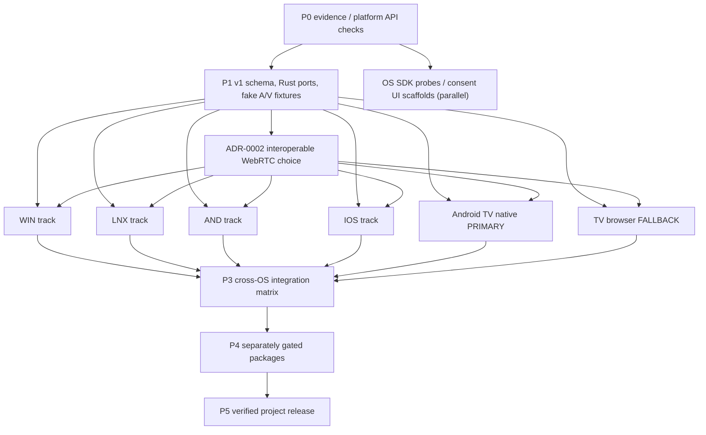

# Implementation roadmap — concurrent platform program (MM-PLAN-001)

## Task 03 discovery update (2026-10-18)

CORE has proposed mDNS browser and publisher candidates in `mm-adapter-discovery`, using pinned `mdns-sd 0.21.5`. Browsing is bounded to two seconds; publication accepts explicit caller-supplied identity, local addresses, and metadata and publishes only the candidate v1 TXT schema on port 8765. Nineteen discovery/publication unit tests pass on Windows; full workspace formatting, strict Clippy, and tests pass (111 unit tests plus 21 integration tests). GNU/Linux cross-target checks pass on Rust 1.99.1 and 1.85. No test opens sockets or verifies multicast on a LAN. The publisher is not connected to app startup or a user-facing discoverability control. See proposed [ADR-0012](adr/0012-mdns-discovery-candidate.md) and [ADR-0013](adr/0013-mdns-service-publication-candidate.md). Mobile discovery, platform permissions, and cross-track approval remain open.

**Status (2026-10-18):** The Rust workspace now includes `mm-transport`: bounded SDP/ICE control, session/reconnect state, RTP timestamp conversion, an encoded-frame queue, a synthetic I420 source, and a metadata-only async WebRTC engine port. Rust formatting, Clippy and the workspace suite pass (111 unit tests, 3 FFI integration tests, 2 pairing-runtime integration tests, 6 identity integration tests, and 10 SQLite integration tests; the unit count includes 19 mDNS discovery/publication tests, 10 Windows identity tests, 8 Linux identity tests, and 9 pairing-runtime tests). ADR-0002 selects libwebrtc through `flutter_webrtc` for Flutter targets, native Kotlin libwebrtc for Android TV, and browser WebRTC APIs for the fallback. The Flutter WebRTC package is pinned and resolved, and a metadata-only Dart adapter is analyzed and fake-tested; the native plugin build is still blocked by Windows plugin symlink support. No peer, network, capture permission or media stream has been established. Flutter shell analysis/tests and the Windows shell build have prior pass evidence; the web capability shell has seven passing Node tests and an Edge 155 desktop localhost smoke. The local Flutter demo still follows only `Idle → Discovered → Pairing → Stopped`; shared FFI review remains pending in [ADR-0008](adr/0008-flutter-demo-session-ffi.md). Hardware interoperability remains unverified and is deferred while software implementation continues. See the [Task 02 brief](../codex/02-transport-spike.md), [ADR-0002](adr/0002-transport-spike.md), [transport status report](spikes/transport-experiment-blocker.md), and the [implementation ledger](IMPLEMENTATION_STATUS.md). Linux, Android, iOS and Android TV builds remain unverified.
**Approved priority (2026-10-18):** Windows, Linux, Android, and iOS **start concurrently**. Native Android TV is the **primary** television receiver; the browser receiver is an **optional compatibility fallback**, not universal TV support.

## Delivery model

Use **six technical tracks plus one shared integrator** rather than a Windows-first waterfall. A realistic planning assumption is 5–7 available technical owners/agents and test access to Windows, Wayland Linux, Android phones, iOS devices, Android TV hardware and at least one TV browser. A single developer/Codex instance can work through the tracks in repeated short rounds with the *same priorities*; the dates then extend significantly.

| Track / branch | Owns (no shared-core edits without approval) | Primary fixture | First proven output |
|---|---|---|---|
| CORE (`feat/core-*`) | `crates/mm-{domain,application,ports,protocol,security,runtime,ffi}/`; golden fixtures | all CI runners | stable v1 protocol/state + synthetic sender/receiver |
| WIN (`feat/win-*`) | `crates/mm-adapter-win/`, `apps/mirrormesh_flutter/windows/`, Windows packaging | Win11 x64 GPU PC | physical capture/send, native receive |
| LNX (`feat/linux-*`) | `crates/mm-adapter-linux/`, `apps/mirrormesh_flutter/linux/`, Linux packaging | Wayland GNOME/KDE | PipeWire capture/send, native receive |
| AND (`feat/android-*`) | `crates/mm-adapter-android/`, Flutter Android phone plugin, phone packaging | Android ARM64 phone/tablet | MediaProjection sender, native receiver |
| IOS (`feat/ios-*`) | `crates/mm-adapter-ios/`, Swift plugin, iOS build/signing | physical iPhone/iPad + Mac | supported-OS capture/send and native receive |
| TV (`feat/tv-native-*`) | `apps/android-tv/`, TV native decoder UI | actual Android TV/Google TV | installable D-pad receiver, H264 rendering |
| WEB (`feat/tv-web-*`) | `apps/tv-web/`, browser receiver tests & deploy | actual TV browser + Chromium | feature-gated browser receiving over secure signaling |

**Branch collision rule:** only CORE can change shared DTOs; track owners must propose versioned contract changes through an issue + cross-track review. Each PR uses a single task brief, its own affected paths, and mandatory tests. Rebase against `main` daily; automated mocks mean a missing mobile device never blocks unrelated merges.

## Dependency DAG

The `ADR-0002` edge gates integration with **real WebRTC**, not SDK scaffolding or simulated-media adapter tests; those can proceed concurrently. The WEB and TV tracks use the same signaling/pairing contract but distinct UI/decoder stacks.

## P0 — evidence, security, SDK feasibility (weeks 1–2)

1. Create repository with `AGENTS.md`, CODEOWNERS, issue/PR templates, secure secrets storage and CI skeleton.
2. Obtain affirmative authorization for lawful reference-app analysis. Run [task 00](../codex/00-rea-investigation.md); keep raw proprietary binaries out of project.
3. Verify latest platform SDK details: Windows WGC/Media Foundation; Linux portal/PipeWire; Android MediaProjection foreground services; Apple ScreenCaptureKit deployment and ReplayKit legacy viability.
4. Verify Android TV native receiver app deployment, MediaCodec H264 support and D-pad focus; separately inspect TV browser secure-origin/WebRTC limitations.
5. Document network threat model, role-specific QR pairing, TLS certificate pinning / verified fingerprints, Android TV user approval.
6. Assign physical test devices and develop baseline fixtures. A track without a device starts API/CI/mock work but is marked `BLOCKED` for hardware acceptance.

**P0 gate:** research log with fact/inference/unknown distinctions; OS API table with minimum tested SDK; hardware owners and security threat review.

## P1 — protocol/FFI contract + six project scaffolds (weeks 1–3)

1. CORE creates `Cargo.toml`, shared `mm-domain`, `mm-ports`, `mm-protocol`, `mm-security`, `mm-ffi` plus compiled mock components.
2. Freeze protocol v1 JSON envelopes, authenticated signaling semantics, codec capability/consent negotiation, receiver roles, version rejection and strict message bounds. Schema golden fixtures under `tests/protocol-golden/`.
3. Implement synthetic timestamped H264 test source and fake transport plus bounded media queues; control-state tests for 100 start/stop cycles.
4. CORE and media specialist complete [task 02](../codex/02-transport-spike.md), compare `str0m`/GStreamer/libwebrtc and record ADR-0002 (one chosen path shared by all).
5. All six track owners initialize buildable platform shells + FFI/IPC unit mocks and compile smoke actions in CI. Native captures stay gated behind permissions.
6. Gate shared contract PR before every real-media integration, while SDK/GUI/mock tasks may already be in flight.

**P1 gate:** shared contract CI is authored but not run remotely; Android TV emulator build is outstanding; Flutter Windows shell compiles, Linux bridge packaging is configured but awaits a Linux runner, and Android/iOS builds are not yet run; TV web unit tests pass; iOS macOS/Xcode compile is assigned to CI but unverified here. No platform claims a real stream.

**Current P1 status:** Rust CORE format, check, Clippy, unit tests, and FFI integration tests pass locally. The protocol parser validates the common envelope, v1 message vocabulary, field bounds, known grant names, UUIDs, and per-peer/session monotonic sequence. One valid `session.offer` golden fixture is included. `mm-security` parses approved numeric IP endpoints, strict QR v1 fields, and OS-random 128-bit one-time pairing nonces with a 120-second local monotonic deadline. `mm-domain` validates trusted-peer records, scoped grants, timestamps, and revocation; `mm-ports` defines storage, identity, capture, codec, control transport and asynchronous WebRTC engine boundaries. `mm-application` composes invitation creation, nonce checks, signed-proof verification through the identity port, pending explicit approval, grant-subset validation, and trust persistence through the store port. These coordinator tests use fakes; the `mm-adapter-identity` public-key verifier candidate has six passing RFC 8032 and negative-input tests. `mm-adapter-win` adds ten fake-store tests for local signing, key lifecycle, and canonical proof-message validation; it does not exercise Credential Manager at runtime. `mm-store::SqliteTrustedPeers` has ten persistence tests; its concrete adapter is not yet assembled into platform app startup. A generic `mm-runtime::PairingRuntime` now composes the coordinator with local identity and trusted-peer ports and passes nine focused fake-backed tests. Concrete Windows/SQLite adapter assembly into platform startup, other platform key stores, QR UI, authenticated signaling, DNS resolution, and network connection remain open. Linux, Android, and iOS SQLite builds are unverified. Task 02 adds bounded transport control and a synthetic I420 source; ADR-0002 selects libwebrtc, and the pinned Flutter plugin now has a metadata-only Dart adapter; no peer connection, authenticated signaling, media stream or renderer is integrated. Flutter and TV shells remain local demos. The web shell has seven passing Node tests; Android TV source/static and local approval-state checks pass. Hosted CI and source SBOM generation remain unrun. FFI review is pending in [ADR-0008](adr/0008-flutter-demo-session-ffi.md). Platform builds, signaling, real media and hardware checks remain incomplete.

## Kickoff workstream status

These statuses describe scaffold and kickoff evidence. **No platform has passed a sender-to-receiver media test.** The next tasks are assigned in the linked task briefs.

| Workstream | Status | Evidence and limitation | Next task |
|---|---|---|---|
| CORE | IN PROGRESS | Rust workspace gates pass; Task 02 transport controls and engine port are tested, but the native plugin build and authenticated signaling are not verified. | Build the pinned plugin on a runner with Windows plugin symlink support, then connect it to authenticated signaling without moving pixels through FFI. |
| WIN | COMPILES | Windows release shell packages `mm_ffi.dll`; bridge test and hidden startup/module-load smoke pass. No WGC capture or media path. | Continue the mock/native API harness in [05a](../codex/05a-windows.md); real media waits for ADR-0002. |
| LNX | BLOCKED | CMake and CI configure `libmm_ffi.so` packaging; no Linux runner result is available. | Run the native bridge bundle test on the Linux runner in [05b](../codex/05b-linux.md). |
| AND | BLOCKED | ARM64 Rust/APK packaging is configured; Android SDK/NDK is absent locally and no device test ran. | Build and inspect the ARM64 APK in [05c](../codex/05c-android.md). |
| IOS | BLOCKED | Device static-link/export configuration exists; no macOS/Xcode runner or supported physical-device validation is available here. | Run the device link job and record the supported capture API gate in [05d](../codex/05d-ios.md). |
| TV | BLOCKED | Native source, D-pad checks, and JDK demo-state tests pass; no APK build or physical TV is available. | Build/install the primary receiver shell, then test its MediaCodec path in [05e](../codex/05e-android-tv.md). |
| WEB | PASS — desktop browser smoke | Strict TypeScript build and 7 Node tests pass; headless Edge 155 localhost smoke detects secure origin, WebRTC, and H.264. No signaling, media, or TV model was tested. | Run capability and remote-focus checks on a named TV-browser fixture in [05f](../codex/05f-browser-receiver.md). |
| GUI | PASS — demo state flow | Flutter analysis and 20 tests pass with the native Windows DLL; the preview has no frame or snapshot source. | Complete CORE/GUI review, then advance the surface/snapshot work in [04](../codex/04-ui-annotations.md). |
| QA | BLOCKED for release | Local Rust audits pass; Flutter runtime notices are regenerated from the locked package graph. The repository is pushed, but hosted workflow results remain unreviewed; Android/iOS package notices and release-package evidence are incomplete. | Review hosted CI and finish platform package notices in [06](../codex/06-quality-release.md). |
| RESEARCH | BLOCKED for REA | Official API research is recorded; no proprietary binary analysis was performed without confirmed authorization and a local target. | Continue public-source research; run [00](../codex/00-rea-investigation.md) only when its authorization and fixture prerequisites are met. |

**Task 03 identity provider:** Proposed [ADR-0007](adr/0007-ed25519-identity-candidate.md) sets Ed25519 raw 32-byte public keys, 64-byte signatures, and SHA-256 fingerprints over raw key bytes. A stateless verifier candidate in `mm-adapter-identity` pins `ed25519-dalek 3.0.0`, `curve25519-dalek 5.0.0`, and `sha2 0.11.0`; six RFC 8032 and negative-input tests pass. Its canonical-key and low-order checks plus `verify_strict` profile still need cross-track/security approval. Proposed [ADR-0009](adr/0009-windows-identity-key-storage.md) adds the signing lifecycle port and a Windows Credential Manager candidate in `crates/mm-adapter-win/`; ten fake-store tests pass, but no real credential was written. Proposed [ADR-0010](adr/0010-pairing-runtime-composition.md) adds generic runtime composition with nine passing fake-backed tests; concrete Windows/SQLite assembly into platform startup remains open. Linux, Android, and iOS key stores, platform app assembly, and protocol-v1 approval remain open. See the [identity-provider spike](spikes/identity-provider.md).

## P2 — concurrent native workstreams (weeks 3–9)

- **WIN:** [task 05a](../codex/05a-windows.md): WGC + MF encode/decode + D3D texture + installer prototype.
- **LNX:** [task 05b](../codex/05b-linux.md): portal/PipeWire + render + VAAPI/V4L2 probe + package prototype.
- **AND:** [task 05c](../codex/05c-android.md): Kotlin MediaProjection/MediaCodec + phone receive/foreground service.
- **IOS:** [task 05d](../codex/05d-ios.md): Swift ScreenCaptureKit capture on verified OS; VideoToolbox decoder/encoder; native receiver independently of capture support.
- **TV primary:** [task 05e](../codex/05e-android-tv.md): installable lean-back style receiver; H264 decode and TV remote pairing/stop.
- **WEB fallback:** [task 05f](../codex/05f-browser-receiver.md): secure-origin web receiver, device/codec checks, QR handshake, documented unsupported states.

One owner per track creates ≤small, reviewable PRs: `scaffold → consent/adapter → fake A/V → real A/V → teardown & tests`. No one track waits for Windows alpha; all interface changes come through CORE.

**P2 gate per track:** completed native build/run evidence plus test permission UX, receive/send as applicable, explicit unavailability behavior, resource cleanup, H264 cross-peer result; iOS missing API/older OS documented and never bypassed.

## P3 — shared UX & cross-platform convergence (weeks 8–12)

1. Integrate [task 03](../codex/03-discovery-pairing.md): mDNS/manual address, verified QR identity, permission scoped grants, re-pair/revoke, WSS errors. TV remote approval must be straightforward and deny-by-default.
2. Integrate [task 04](../codex/04-ui-annotations.md): shared Flutter GUI, native textures, screenshots with/without overlays, normalized doodles, Android TV overlay implementation, browser controls as capabilities allow.
3. Run [task 07](../codex/07-integration-matrix.md), at minimum:

| Required tested scenario | Why |
|---|---|
| WIN → WIN native and WIN → Android TV | desktop baseline and TV primary |
| LNX → WIN native and LNX → Android TV | Linux sender on real hardware |
| AND → WIN native and AND → Android TV | phone permission/rotation and TV |
| IOS → WIN native and IOS → Android TV **if API supported** | real iOS sender; otherwise record blocked OS/device + receiver-only |
| WIN → LNX native, WIN → Android phone native, WIN → iOS native | prove each additional receiver |
| WIN → TV browser **on one documented supported browser** | fallback viability; skip only with explicit unsupported report |

4. Test reject/revoke, LAN isolation, reconnect and source change; compare features with capability flags, no optimistic GUI promises.
5. Every platform’s test run includes screenshot/doodle or an explicit platform limitation if OS presentation restrictions prevent it.

**P3 gate:** every intended shipping **sender** reaches Android TV and at least one desktop; native receivers tested; TV web fallback passes on at least one named browser/model or ships visibly unavailable.

## P4 — parallel packaging and benchmarking (weeks 11–16)

- Windows x64 MSIX/signed installer + GPU tests.
- Linux x64 `.deb`/AppImage + Wayland/X11 runtime dependency tests.
- Android ARM64 phone APK/AAB and **separate** Android TV APK/AAB, consent and TV remote tests.
- iOS ARM64 signed IPA/TestFlight using Mac/Xcode and devices; release of a receiver-only mode must be described explicitly if full-screen sender OS gate fails.
- Run [task 06](../codex/06-quality-release.md), signing/SBOM/license checks, clean install/uninstall, 60-minute soak, external latency p50/p95 and frame-loss counters. Test hardware codecs per device and log exact GPU/SoC/driver/OS.
- Android TV is a hard functional TV gate for the primary path. Browser fallback is published only for verified TV browser engines/models, not advertised as generic.

## P5 — public release backed by evidence (weeks 15–20)

- Release dashboard records `PASS / FAIL / BLOCKED` for WIN, LNX, AND, IOS, Android TV and WEB separately.
- Add download links only after test and signing/pass checks; iOS distribution by TestFlight/App Store with approval when available. Do not invent public `.ipa` link when Apple distribution is pending.
- If one platform is blocked, keep development active in parallel but **do not advertise it as shipping**. Publish working platform artifacts as a clearly labeled partial pre-release if desired.
- Update [README](../README.md), [device matrix](device-matrix.md) and [verification ledger](verification.md) with measured capability paths and independent product icon/screenshots; add changelog and limitations.

## P6 — protocol extensions (only after core verification)

Explore Cast, Miracast, clean-room AirPlay adapters, optional TURN and PSP/Linux-phone concepts as separate spikes/ADRs. They are not implied by Android TV/web support.

## Success metric and decisions

Per native track: install/launch pass, consent capture and stop pass, external receiver visible, decoding receives known sender, security gates, measured p50/p95, screenshot export, annotation alignment, 60-minute soak. Per TV track: QR approval, fullscreen playback, remote disconnect and fail-safe behavior on codec/secure-origin failures. Any missing OS SDK/device prevents a supported status, **not** concurrent engineering work.

Planning windows assume staffed tracks and access to real hardware. They are estimates, not contractual delivery dates.
